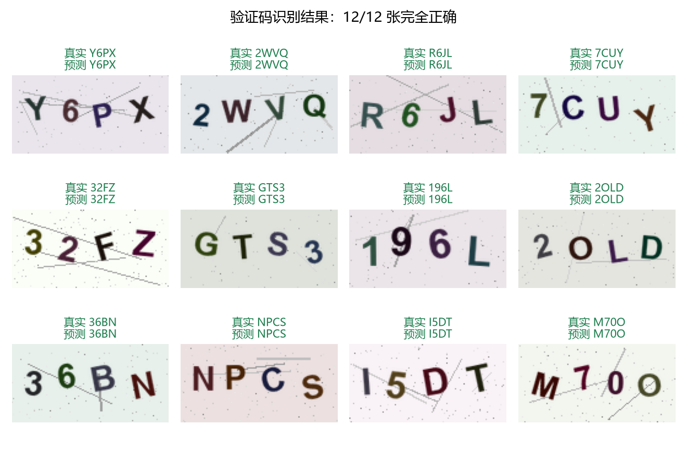
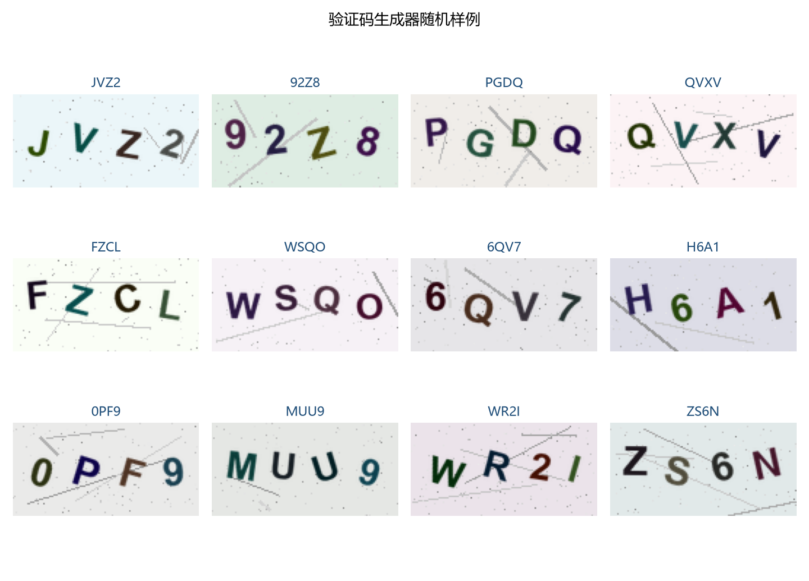
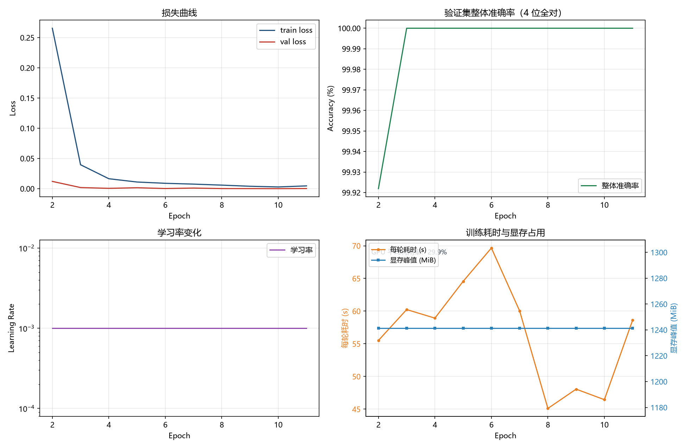

# captcha-cnn-pytorch

<div align="center">

**用 PyTorch 从零实现的多输出 CNN 验证码识别器**

[](https://www.python.org/)
[](https://pytorch.org/)
[](LICENSE)

</div>

---

## 效果

<div align="center">

</div>

验证集整体准确率 **100.00%**（3200 张全新样本，4 位全对）。

<div align="center">

</div>

### 训练曲线

<div align="center">

</div>

训练日志里记录了每一轮的**耗时、显存峰值和 GPU 利用率**，
曲线图右下角就是这三项的变化，可以直观看出瓶颈在哪。

## 这个项目做了什么

- **验证码生成器从零手写** —— 纯 Pillow + numpy，不依赖第三方 `captcha` 库
- **数据无限生成** —— 每次取样本现场画一张新图，不存在过拟合到固定图片的问题
- **多输出 CNN** —— VGG 风格卷积主干 + 4 个独立分类头，每位字符单独判断
- **自带自适应优化器** —— LAMB / Lion / RAdam 纯 PyTorch 实现，零额外依赖
- **中文注释** —— 每个设计决策都写清了「为什么」，适合逐行讲解

## 快速开始

```bash
# 1. 安装依赖
pip install -r requirements.txt
# 需要 GPU 的话装 CUDA 版：
# pip install torch --index-url https://download.pytorch.org/whl/cu128

# 2. 训练（自动选择 CPU / GPU）
python train.py

# 3. 看训练好的模型识别效果
python predict.py --num 12

# 4. 算一下准确率
python evaluate.py --batches 20
```

> 首次运行会先花几分钟训练（CPU 上约 55 秒/轮），之后 `predict.py` 直接用
> `checkpoints/captcha_cnn_best.pt` 推理。

## 常用参数

```bash
python train.py --device cpu                    # 强制用 CPU
python train.py --device cuda                   # 强制用 GPU
python train.py --epochs 2 --steps-per-epoch 20 # 快速跑一遍，验证流程通不通
python train.py --no-refine                    # 只跑第一阶段
python train.py --resume checkpoints/captcha_cnn_best.pt  # 接着上次继续练
```

## 优化器与自动学习率

项目支持多种「自带自动学习率机制」的优化器，用 `--optimizer` 切换：

```bash
python train.py --optimizer lamb      # 逐层自适应，最接近「不用调 lr」
python train.py --optimizer lion      # sign 动量，不用 warmup
python train.py --optimizer radam     # 自适应项自动退化，不用 warmup
python train.py --optimizer adamw     # 解耦权重衰减
python train.py --optimizer adam      # 原始基线
```

| 名字 | 机制 | 推荐 lr | 特点 |
|---|---|---|---|
| `adam` | 二阶动量自适应 | `1e-3` | 基线 |
| `adamw` | Adam + 解耦 weight decay | `1e-3` | 现在的默认首选，比 Adam 稳 |
| `radam` | 可纠正项 ρ_t | `1e-3` | 早期自动退化成 SGD-Momentum，**不用 warmup** |
| `lion` | `sign(动量)` | `2e-4` | 更新方向取符号，天然稳，显存省一半，**不用 warmup** |
| `lamb` | 逐层信任比 `‖w‖/‖u‖` | `1e-3` | 每层自动缩放步长，**基本不用调 lr** |

> **关键区别**：这些优化器的「自动」是**按层/按参数自动缩放**，
> 不是凭空决定学习率大小。所以基础 `lr` 还是给一个，只是宽容度大得多。

另外还有一层「学习率大小随训练进程自动变化」的调度器，用 `--scheduler` 切换：

```bash
python train.py --scheduler plateau   # 验证损失停滞时自动减半（默认，最稳）
python train.py --scheduler cosine    # 余弦平滑降温，可完全替代两阶段策略
python train.py --scheduler none      # 关闭，回到原来的手动两阶段
```

- **plateau**（`ReduceLROnPlateau`）：靠验证损失驱动，验证损失连续
  `--scheduler-patience` 轮不改善就把 lr 乘以 `--scheduler-factor`。
  你的数据是「无限生成」的，验证集一直有噪声，这种「看指标才调」的策略最合适。
- **cosine**（`CosineAnnealingLR`）：按步数平滑降温，每个 batch 调一次。

### 推荐的组合

```bash
# 最省心：LAMB 的逐层自适应 + plateau 兜底
python train.py --optimizer lamb --scheduler plateau

# 想看学习率曲线怎么走：余弦平滑
python train.py --optimizer adamw --scheduler cosine
```

> 使用 `--scheduler plateau/cosine` 时，学习率完全交给调度器，
> `--refine-epochs` 和 `--lr-min` 不再生效（已经没有「手动降 lr 的第二阶段」了），
> `--epochs` 就是总轮数，EarlyStopping 负责收尾。

训练曲线图会多画一条**学习率变化**子图（对数坐标），
一眼就能看出手动两阶段和自动调参的差别。

## 用 uv 管理环境（推荐）

项目自带 `pyproject.toml`，用 [uv](https://docs.astral.sh/uv/) 管理虚拟环境：

```bash
uv sync                 # 创建 .venv 并安装依赖
uv run python train.py # 在虚拟环境里跑训练
```

`pyproject.toml` 里已经配置了 PyTorch 官方的 **CUDA 12.8 索引源**：

```toml
[[tool.uv.index]]
name = "pytorch-cu128"
url = "https://download.pytorch.org/whl/cu128"
explicit = true

[tool.uv.sources]
torch = { index = "pytorch-cu128" }
torchvision = { index = "pytorch-cu128" }
```

所以 `uv sync` 会**自动装 CUDA 版**的 PyTorch（`torch 2.11.0+cu128`），不需要额外操作。

确认一下装的是 CUDA 版：

```bash
uv run python -c "import torch; print(torch.__version__, torch.cuda.is_available())"
# 期望输出类似：2.11.0+cu128 True
```

如果想改成 CPU 版，把 `[tool.uv.sources]` 那两行删掉，再 `uv sync` 即可。

## 目录结构

```
pytorch-captcha-cnn/
├── captcha_gen.py      # 验证码生成器（纯 Pillow + numpy，不依赖 torch）
├── dataset.py          # 把生成器包装成 PyTorch Dataset / DataLoader
├── model.py            # CNN 模型
├── optimizers.py       # LAMB / Lion / RAdam 等自带自动学习率的优化器
├── train.py            # 训练脚本
├── predict.py          # 识别并画对比图
├── evaluate.py         # 算整体准确率和每一位的准确率
├── make_samples.py     # 生成验证码样例图（README 用）
├── plotting.py         # matplotlib 中文字体设置
├── fonts/              # 可选：自带的字体文件
├── docs/               # README 用到的图片
├── samples/            # 生成的样本图（git 忽略）
├── figures/            # 训练曲线、预测样例（git 忽略）
└── checkpoints/        # 模型权重和训练日志（git 忽略）
```

## 模型结构

```
输入 (B, 3, 64, 128)
  │
  ├─ Block1: Conv3x3(32) ×2 + BN + ReLU + MaxPool   → (B,  32, 32, 64)
  ├─ Block2: Conv3x3(64) ×2 + BN + ReLU + MaxPool   → (B,  64, 16, 32)
  ├─ Block3: Conv3x3(128) ×2 + BN + ReLU + MaxPool  → (B, 128,  8, 16)
  ├─ Block4: Conv3x3(256) ×2 + BN + ReLU + MaxPool  → (B, 256,  4,  8)
  ├─ Block5: Conv3x3(256) ×2 + BN + ReLU + MaxPool  → (B, 256,  2,  4)
  │
  ├─ Flatten → (B, 2048)
  ├─ Dropout(0.5)
  │
  └─ 4 个独立的分类头 Linear(2048, 36)
       ├─ 头1 → 第 1 位字符的 36 类概率
       ├─ 头2 → 第 2 位字符的 36 类概率
       ├─ 头3 → 第 3 位字符的 36 类概率
       └─ 头4 → 第 4 位字符的 36 类概率
```

关键点：卷积部分提取的特征是所有字符**共享**的（笔画、轮廓这些确实通用），
但「这一位是哪个字符」要各自独立判断，所以最后分成 4 个分类头。

**注意展平之后直接接分类头，中间没有共享的全连接层。**
这不是随便定的：Flatten 出来的 2048 维里还带着「哪一块区域对应哪一位」的信息，
中间再压一层会把这部分空间信息抹掉，网络得重新学「第几位长什么样」，收敛会慢很多。
这是本项目实测踩过的坑（见下方「实验记录」）。

这样天然得到两个指标：

- **单字符准确率**：每一位分别统计
- **整体准确率**：4 位全对才算这张验证码答对（更有意义）

损失函数是 4 个交叉熵之和。

## 实测结果

环境：Python 3.13、PyTorch 2.11.0+cu128、NVIDIA RTX 3060 Laptop GPU。

| 轮数 | 学习率 | 训练 loss | 验证 loss | 整体准确率 |
|---|---|---|---|---|
| 1 | 1e-3 | 6.2420 | 0.0562 | 99.14% |
| 2 | 1e-3 | 0.0644 | 0.0205 | 99.64% |
| 4 | 1e-3 | 0.0176 | 0.0060 | 99.90% |
| 7 | 1e-3 | 0.0107 | 0.0007 | **99.97%** |

用 `evaluate.py` 在 **3200 张全新样本**上评估：

```
整体准确率（4 位全对）：3197/3200 = 99.91%
各位置准确率：
  第 1 位：3199/3200 = 99.97%
  第 2 位：3199/3200 = 99.97%
  第 3 位：3199/3200 = 99.97%
  第 4 位：3200/3200 = 100.00%
```

模型大小约 10.6 MB，参数量 2,650,416，单轮训练约 65~78 秒。

参考项目 [ypwhs/captcha_break](https://github.com/ypwhs/captcha_break) 的 Keras 版
报告的整体准确率是 98.26%，本项目略高一些（两边验证码生成器的难度略有不同）。

### 实验记录：中间加一层共享全连接会慢很多

最初的版本在 Flatten 之后加了一层 `Linear(2048, 512)` 再接 4 个头。
用同样的 128 张固定样本反复训练，对比收敛速度：

| 训练步数 | 有 512 维瓶颈 | 去掉瓶颈（当前版本） |
|---|---|---|
| 10 | 整体 0.8% | 整体 **61.7%** |
| 20 | 整体 7.8% | 整体 **96.9%** |
| 30 | 整体 35.2% | 整体 **100.0%** |
| 60 | 整体 71.1% | 整体 100.0% |

结论：中间的 512 维瓶颈把空间信息抹掉了，收敛速度差了将近一个数量级。
这个对比很适合在课堂上讲「网络结构的设计不是随意的」。

## 训练策略

默认是**手动两阶段**学习率（原参考项目的技巧，效果比一直用一个学习率好）：

1. **阶段 1**：学习率 `1e-3`，快速收敛
2. **阶段 2**：学习率降到 `1e-4`，精修

也可以切换成**自动学习率**（见上面「优化器与自动学习率」一节），
用 `--scheduler plateau` 或 `--scheduler cosine` 让学习率自己调。

两种模式都有 EarlyStopping（验证集准确率连续 8 轮不提升就停），
始终保存验证准确率最好的那份权重。

## 参考

- [ypwhs/captcha_break](https://github.com/ypwhs/captcha_break) — 原始 Keras 实现
- PyTorch 官方文档：<https://pytorch.org/docs/stable/index.html>

## License

MIT
